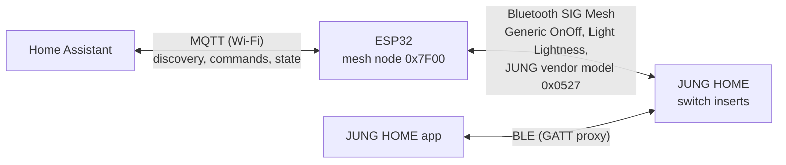

# JUNG HOME ESP32 Gateway

A ~€5 ESP32 that replaces the €233 JUNG HOME Gateway: it joins an existing
**JUNG HOME Bluetooth Mesh** network and exposes every switch to
**Home Assistant** over MQTT, fully local, no cloud.

- **On/off and dimming** for every channel, with instant two-way sync:
  pressing a wall rocker updates Home Assistant within seconds
- **RGB status LEDs** of each switch (colour when on / when off) as Home
  Assistant lights, usable in automations
- **Auto-discovery**: devices, areas and controls appear in Home Assistant
  by themselves
- **Over-the-air updates with automatic rollback**: a firmware that cannot
  reach MQTT within 5 minutes, or crashes, boots the previous version again
- **Mesh console and passive sniffer** over MQTT, which is how the JUNG
  vendor protocol for the LEDs was reverse engineered

The JUNG HOME app keeps working alongside it.



## How it works

JUNG HOME devices are standard Bluetooth SIG Mesh nodes. The JUNG app can
export the project, and that export contains the mesh configuration
database (Mesh CDB) with the network and application keys. With those keys
the ESP32 joins the network as one more node (no provisioner, no gateway)
and talks to the switches with standard SIG models:

| Function | Mesh model |
| --- | --- |
| On/off | Generic OnOff Client → Server `0x1000` |
| Brightness | Light Lightness Client → Server `0x1300` |
| Status LED colours | JUNG vendor model (CID `0x0527`), see [docs/PROTOCOL.md](docs/PROTOCOL.md) |

State changes made at the wall reach Home Assistant through the switches'
group publications. Where a switch does not publish (one insert stays
silent when switched off), the sniffer spots the rocker's command and the
bridge re-reads that light 2.5 s later.

## Hardware

- Any ESP32 with Bluetooth LE. Developed on an ESP32-D0WD-V3 DevKit with
  4 MB flash.
- A USB power supply, placed roughly in the middle of the switches
  (BLE range is about 10 m indoors).

## Quick start

1. Export your project from the JUNG HOME app and copy the `.json` file into
   this folder as `JungHome.json` (git-ignored).
2. Generate the mesh part of your config and a light list:
   ```bash
   python3 tools/extract_keys.py JungHome.json
   ```
3. `cp src/secrets.example.h src/secrets.h`, paste the mesh lines, and fill in
   Wi-Fi and MQTT credentials. Adapt `src/lights.h` to your switches.
4. Build and flash with [PlatformIO](https://platformio.org/):
   ```bash
   pio run -t erase                 # first flash only
   pio run -t upload -t monitor
   ```
5. The lights appear under **Settings → Devices & services → MQTT**.

The full step-by-step guide, including the Home Assistant side, is in
[docs/SETUP.md](docs/SETUP.md).

## Updating over Wi-Fi

```bash
pio run && python tools/ota.py
```

`tools/ota.py` serves the image from your computer, triggers the update
over MQTT and reports whether the new version stuck or was rolled back.
Only bootloader or partition changes need USB.

## Mesh console

```bash
# read the "LED colour when off" parameter of node 0x000F
python tools/mesh_console.py '{"dst":"000F","op":"C20527","data":"02A0"}'
```

Publishing `on` to `jungmesh/debug/sniff` makes the bridge decrypt and
publish all traffic between other nodes (for example JUNG app ↔ switch) to
`jungmesh/debug/rx`.

## MQTT topics

| Topic | Payload |
| --- | --- |
| `jungmesh/<id>/set`, `jungmesh/<id>/state` | `{"state":"ON","brightness":128}` |
| `jungmesh/<id>/led_on/set`, `.../led_off/set` | `{"state":"ON","color":{"r":255,"g":0,"b":0},"brightness":200}` |
| `jungmesh/bridge/status` | `online` / `offline` |
| `jungmesh/bridge/version` | firmware version |
| `jungmesh/bridge/ota` | firmware URL to install |
| `jungmesh/debug/tx`, `/rx`, `/sniff` | mesh console |

## How this was built

This project was built in two days as a pair-programming session between
me and an AI coding agent ([Claude Code](https://claude.com/claude-code)).
I brought the hardware, the home, physical observation ("which side turned
red?") and the decisions; the agent wrote the firmware and the tooling and
did most of the investigation, including:

- joining an existing mesh with a known key set through ESP-IDF internals,
  after reading the stack's source to find out why the first attempt failed
- building a passive sniffer by wrapping the mesh stack's transport layer
  at link time, then reverse engineering the JUNG LED protocol from the
  decrypted traffic of the JUNG app
- finding firmware quirks in the switches from captured traffic (garbage
  target values in status messages, a switch that never reports "off") and
  working around them
- proving the OTA rollback by deliberately shipping a broken image

[docs/PROTOCOL.md](docs/PROTOCOL.md) documents what was found and how.

## Disclaimer

This is an independent project, not affiliated with or endorsed by
Albrecht Jung GmbH & Co. KG. JUNG and JUNG HOME are trademarks of their
owner. The vendor protocol was documented for interoperability with
equipment I own. It only works with the keys of your own installation.
Use at your own risk.

## License

[MIT](LICENSE)
